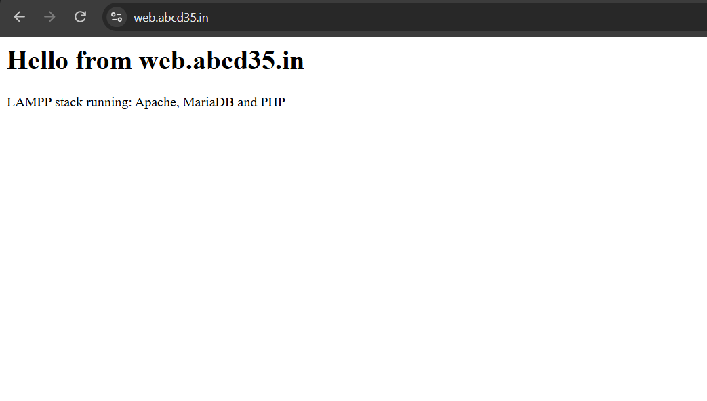
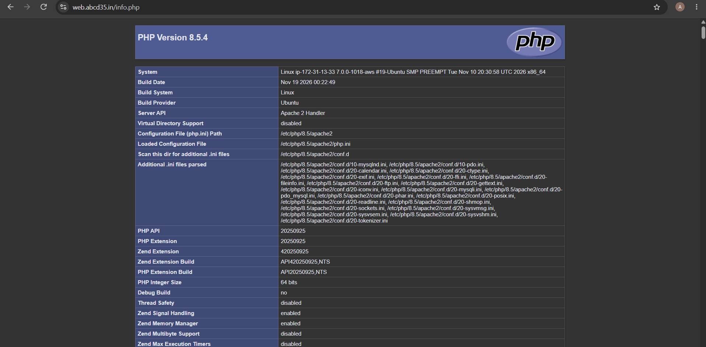
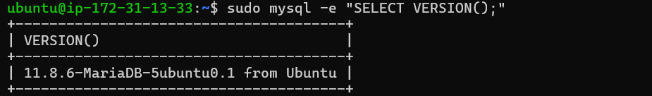

# LAMPP Installation

## Aim
To install and test a LAMPP stack (Linux, Apache, MariaDB, PHP) on an AWS EC2 Ubuntu server, so the server can run dynamic PHP websites with a database.

## What I did
1. Logged in to the EC2 server with SSH.
2. Stopped and disabled Nginx, because Apache and Nginx both use port 80.
3. Installed Apache, MariaDB and PHP with `apt`.
4. Started Apache and MariaDB and set them to start on every reboot.
5. Replaced the Apache default page with my own page.
6. Tested PHP with a temporary `phpinfo()` page, then deleted that page because it shows server details.
7. Checked the database with `SELECT VERSION();`.

## Commands used
| Command | Meaning |
|---|---|
| `sudo systemctl stop nginx` | Stop Nginx so port 80 is free |
| `sudo apt install -y apache2 mariadb-server php libapache2-mod-php php-mysql` | Install the web server, database and PHP |
| `sudo systemctl enable --now apache2 mariadb` | Start them now and at every restart |
| `sudo mysql -e "SELECT VERSION();"` | Show the database version |

## Screenshots

### 1. Website in the browser

### 2. PHP info page

### 3. MariaDB version

## What I learned
- What each part of the LAMPP stack does
- Why two web servers cannot use the same port
- How to test Apache, PHP and the database separately
